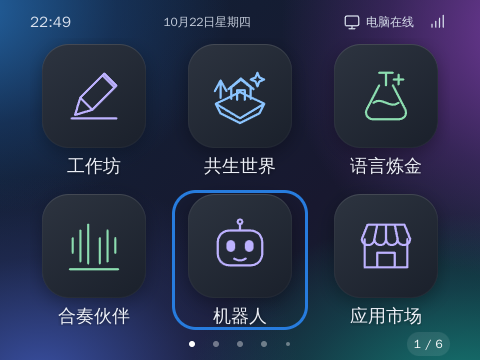

# ATOM · 个人 AI 终端

ATOM 是一台可以独立运行应用、用语音创造作品，并连接个人电脑 Agent 的小电脑。设备保留 Debian 与板厂驱动，以本地服务、全屏桌面和统一应用接口承载交互；复杂开发任务交给用户授权的电脑执行。

[产品官网](https://ldcx.tech/atom/) · [应用目录](https://ldcx.tech/atom/apps/) · [使用指南](https://ldcx.tech/atom/guide/) · [开发文档](atom/docs/README.md) · [协作开发](atom/docs/collaboration.md)



## 当前基线

截至 **2026-10-23**：设备核心 `2026.10.23.2`，Mac 内部测试版 **ATOM Connect 0.6.4**。完整源码库收录 **62 个独立应用**，均包含真实首页封面和完整资源 ZIP；官网、云端和 Mac 已接入同一资源库。源码库收录不等于全部安装，也不等于全部通过五向适配。灰色样机定向升级没有推进公共系统 latest 通道。

[当前状态与待验收事项](atom/docs/current-status.md)集中记录交付范围；[完整资源同步](atom/docs/full-library-sync-2026-10-23.md)记录发布和校验证据。

## 能做什么

| 能力 | 体验 |
| --- | --- |
| 独立桌面 | 480×360、三列两行大图标、平滑分页、首末页回弹；进入应用全屏，退出回到原桌面页 |
| 五向交互 | 方向移动焦点，短按中心键确认，长按语音；共享焦点动画与鼠标输入模式切换 |
| 语音工作坊 | 说出需求、转写编辑、生成、隔离预览、安装；任务反馈来自实际状态 |
| 连接电脑 Agent | 选择授权项目，向电脑 Codex 发任务，查看流式进度、审批、取消和结果 |
| 源码应用市场 | 浏览、获取完整源码、二次创作和明确发布；保留版本、许可及派生关系 |
| 跨端日用应用 | 便签、日程、待办与相册；电脑输入和编辑，小电脑独立呈现 |
| 创意作品 | 光影水池、月光海洋、粒子实验室、音乐与点阵、机器人表情，以及月亮来信、雨夜电台、玻璃生态瓶等 |
| 外观与设备管理 | 明暗切换、主题图标、音量、背光、网络、蓝牙、签名核心更新、数据备份恢复 |

[移植应用来源与授权](atom/ports/README.md) · [AI 原生体验](atom/experiences/README.md) · [相册与生图边界](atom/official/photo-album/README.md)

## 三端如何协作

```text
ATOM 小电脑 ── HTTPS ── 云端账号 / 中继 / 源码市场 ── HTTPS ── ATOM Connect
   │                         │                              │
独立运行应用              公开完整源码库                 授权项目 → 电脑 Agent
语音与硬件交互            账号私有同步数据               编辑、改造、发布作品
```

电脑任务通过带身份认证的 HTTP 轮询中继；Codex 在电脑侧通过 stdio app-server 运行。任务与便签等沿用端到端加密协议；相册是账号私有云端存储，服务器可读。公开源码库与私人数据分开管理。Connect 管理自己的 Agent 会话，不接管现有 Codex 桌面聊天。

小电脑的独立应用不要求电脑开机。云端模型、天气和同步需要联网；电脑任务需要对应电脑开机并运行 Connect。设备没有部署大型本地语言模型。

## 本地启动

```sh
git clone https://github.com/wangqioo/vibeboard-Desk.git
cd vibeboard-Desk
python3 atom/server.py
```

打开 `http://127.0.0.1:8770`。基础桌面使用 Python 3.7+ 标准库；加密配对和系统验签需要 `cryptography`。此入口不自动导入样机应用和私人数据。

如需带仓库应用的隔离模拟设备：

```sh
python3 atom/tools/simulator.py --offline
```

模拟器使用 `http://127.0.0.1:8790/simulator` 和独立 `~/.atom-simulator` 数据目录，不修改宿主机硬件。电脑端开发使用 Node 24+；[Connect 安装、配对与构建](atom/connect/README.md)另有完整说明。Mac App 控制台端口由启动器分配，不应硬编码本机端口。

## 输入与应用开发

- **方向键**模拟摇杆方向；**短按 Space**模拟中心键确认；**长按约 650 ms**唤醒语音，在非密码输入框中用于听写，松手结束录音。
- 返回使用左上角可聚焦的箭头；逐层返回，应用顶层回到进入前的桌面页。**Home**直接返回桌面；已在桌面时回第一页。
- 桌面焦点从应用开始，上下同列、跨页同行；方向输入隐藏鼠标，鼠标移动或点击恢复指针。
- 所有新建、导入、更新和发布的应用必须满足[五向输入强制规范](atom/docs/input-standard.md)。画布必须有语义操作控件或声明只读场景，旧应用不得自动补声明冒充适配。
- 每个应用提供独立透明单色 `icon.svg`；主题控制颜色和图标底板。全屏页面仅允许必要内容区滚动。
- 使用 `AtomApp` 管理启动、64 KiB 独立存档和后台释放；保存成功必须等待设备确认。

开始开发前阅读 [AGENTS.md](AGENTS.md)、[应用开发指南](atom/docs/developer-guide.md)、[运行协议](atom/docs/app-contract.md)和[视觉规范](atom/docs/design-system.md)。发布封面使用真实渲染：首页截图可在 **ATOM Connect → 我的创作 → 首页截图** 上传，当前发布流程要求封面。

## 验证与部署

按改动范围执行测试，不以模拟数据代替实机验收：

```sh
python3 -m unittest discover -s atom/tests -v
node atom/tests/app-host.test.cjs
node atom/tests/app-runtime.test.cjs
node atom/tests/input-navigation.integration.cjs
node atom/tests/joystick-shell.integration.cjs
```

浏览器依赖在 `atom/package.json`；先运行 `npm --prefix atom ci`，再按[协作手册](atom/docs/collaboration.md)安装浏览器并运行对应套件。市场/相册测试另外需要其 requirements 中的图像依赖。

设备、Mac、云端分别发布，不能用一次核心升级代替全部三端部署：

- [Debian 样机部署与恢复](atom/docs/deployment.md)
- [系统升级、数据恢复、Mac 发行](atom/docs/system-maintenance.md)
- [服务器部署与备份](atom/connect/server/README.md)
- [62 项完整源码库同步](atom/docs/full-library-sync-2026-10-23.md)
- [官网构建与发布](atom/site/README.md)

阿里云本地数据库备份和 OSS 对应归档各保留三份；遵守 [AGENTS.md](AGENTS.md) 的成本约束，不因文档整理或例行代码修改新增 ECS 快照或镜像。

## 代码地图

| 路径 | 内容 |
| --- | --- |
| `atom/server.py`、`atom/static/` | 设备 API、桌面、应用宿主与共享输入运行时 |
| `atom/workshop.py`、`atom/voice.py` | 模型任务、录音和受控语音能力 |
| `atom/connect/` | Mac 伴侣、电脑 Agent、中继、市场与服务器运维 |
| `atom/official/`、`atom/ports/` | 官方应用、移植源码及完整资源、上游许可 |
| `atom/legacy-seeds/` | 既有应用兼容快照，不代表五向认证 |
| `atom/design/`、`atom/templates/` | 共享控件样式与应用模板 |
| `atom/tools/`、`atom/tests/` | 构建、校验、部署工具及测试 |
| `atom/site/` | 产品官网、指南与应用目录 |
| `atom/docs/`、`atom/artifacts/` | 维护文档与实测证据 |

根目录早期 Node/Web 平台与 ATOM 分开保留，运行方法见[旧网页平台说明](docs/vibeboard-web-legacy.md)。不要把设备部署目录覆盖到旧项目。

## 原型边界与许可

当前样机基于 RK3566、Mali-G52、Debian 10 / Linux 4.19 / Chromium 91。EGL/WebGL、H.264 硬解、RGA 和 NPU 示例各有实测记录，但不代表所有浏览器编码、语音/OCR 或持续负载已验证，详见[硬件能力](atom/docs/hardware-capabilities.md)。

真实摇杆、所有旧应用逐项五向迁移、蓝牙外设出声、换网与长期电源循环仍需验收。三次正常重启及八小时单应用运行已验收；历史 BSP 显示专项已按用户要求关闭跟进，不代表根因修复，日常避免反复热重启 LightDM/Xorg。Mac 当前是内部 ad-hoc 签名包，Developer ID、公证和 SMTP 尚未完成。完整未验收清单见[当前状态](atom/docs/current-status.md)。

旧浏览器及 `--no-sandbox` 属于原型限制，正式发行需升级受维护底座并完成安全验证。模型凭据、账号、设备状态、个人记录和构建缓存不得提交。各移植项目授权不同，保留各目录 LICENSE、SOURCE 和素材来源；仓库总览不替代上游许可。
