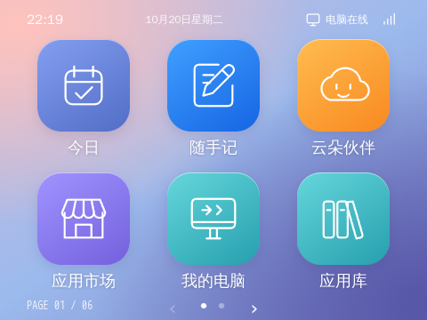
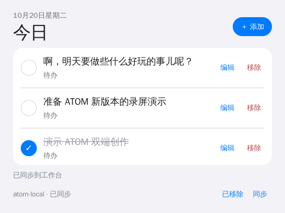
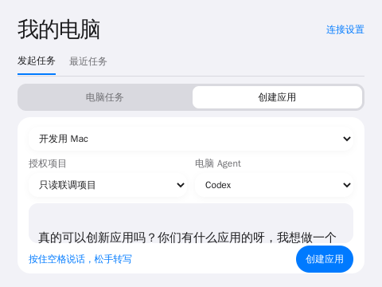
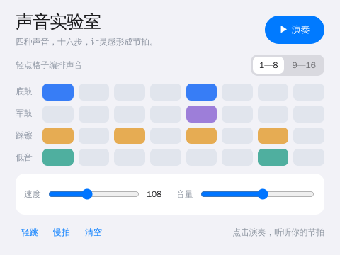

# VibeBoard Desk / ATOM · 独立桌面 AI 终端

ATOM 是运行在 RK3566 小电脑上的全屏应用系统原型。它保留 Debian 和板厂驱动，用本地 Python 服务、Chromium/EGL 和统一的应用规范，将这台设备变成可以独立使用、通过语音创建应用、运行互动图形作品的桌面终端。

**本阶段更新至 2026-10-22。** 当前实现包含独立设备体验与 ATOM Connect 电脑 Agent 桥接原型：独立应用不依赖个人电脑保持开机，电脑任务需要对应电脑在线。应用生成和语音服务调用云端 API；基础应用与已部署素材可以离线运行。这里没有部署大型本地语言模型。



> 仓库保留原有项目；本目录是透明板上的 ATOM 实现。早期计划和验收报告用于追溯，本 README 与[文档索引](atom/docs/README.md)描述当前交付。

## 产品官网与使用指南

[认识 ATOM](https://ldcx.tech/atom/) · [应用目录](https://ldcx.tech/atom/apps/) · [可搜索的使用指南](https://ldcx.tech/atom/guide/)

独立应用目录收录 39 个既有应用与工具，并读取云端市场的新公开作品；支持分类、搜索、界面与获取方式说明、公开源码包下载。大型移植的完整资源要求单独标明。

应用市场使用首页截图作为卡片背景，官网、电脑端和小电脑端共享云端封面资料。电脑端「我的创作 → 首页截图」提供上传和预览，发布前提示补齐封面；当前云端 16 个公开作品均有截图封面。小电脑端本轮更新仍待远程连接恢复后部署，详见 [封面规则与验收](atom/docs/market-covers.md)。

官网已重做产品展示：加入 40 秒 ATOM v3 概念短片、章节跳转和语言炼金的可交互材质预览，作品区精选 12 个现有案例，每 3 秒自动轮播、600 ms 平滑切换，支持暂停与手动切换；重点呈现共生世界、AI 合奏、光影水池、天体观测台等，以及「创造应用 → 改造源码 → 分享新版本」的核心流程。明确区分当前样机与概念硬件。可搜索指南覆盖首次使用、配对、创建、市场、同步、账号恢复与排错。网站源码、媒体来源、设计资料与独立发布脚本位于 [atom/site](atom/site/README.md)，静态路由与现有中继/市场 API 共存。

## 灰色板与四个交互作品 · 2026-10-22

光子芯片、光子快跑、指尖烟花、迷你钢琴已按 ATOM 白天 / 暗黑主题重新适配，具备用途图标、全屏交互、空格返回与退出资源释放，完整源码和真实截图已同步到云端市场、Mac 市场与官网目录。[四个应用的构建与使用](atom/official/gray-ports/README.md)。

灰色板已装入包含 36 个可安装应用的新版应用系统，旧应用服务和历史发布目录已备份清理，并以独立身份配对 Mac；真实 Codex 任务往返已成功。重新开机后实体显示、Mali-G52 加速及 11 个应用已复核。旧 BSP 的图形会话退出等待仍列为已知限制，日常更新避免反复热重启 LightDM。[迁移记录、已测内容与回退](atom/docs/gray-migration.md)。

## 外观、相册与桌边应用 · 2026-10-21

- **白天 / 暗黑**：设备与 ATOM Connect 的设置中一键切换并保存；暗色桌面为蓝紫青绿静态色场，应用内容颜色保持原意。[外观设计与验证](atom/docs/system-appearance.md)。
- **苹果照片导入**：支持 HEIC/HEIF、JPEG、PNG、WebP，单张最多 **20 MiB / 6400 万像素**；服务端生成轻量预览，导出保留原文件。云端与电脑端已验证，样机相册新 bundle 待开机更新。
- **天气之窗**：满屏实拍天气背景，七种天气摄影、手选城市与实时天气数据。[来源与运行边界](atom/official/weather-window/README.md)。
- **掌心节拍**：三种音色、拍号与细分、点按定速，以及本地麦克风拍手定速。[使用说明](atom/official/clap-stage/README.md)。

天气与节拍器已上架两端共用的云端源码市场，浏览器功能验证通过；**样机当前关机，这两款尚未安装或进行真实收音验收**。后续部署项目及验收清单见 [本轮交付记录](atom/docs/delivery-2026-10-21.md)。

## AI 原生体验（研发版）

新增共生世界、语言炼金、合奏伙伴和 Agent 小屋：用语言修改可交互小岛、生成鼠标可操控的 GPU 材质、弹出乐句让 AI 接奏，以及用真实电脑任务驱动的小工作室。[源码、运行边界和测试](atom/experiences/README.md)。四个应用已追加到样机桌面，并以完整源码上架电脑端与设备端共用的云端市场。

## 团队协作入口

新成员先阅读 **[协作开发手册](atom/docs/collaboration.md)**：本地启动、目录分工、应用构建、浏览器测试、样机更新和分支协作。实际密钥与登录状态通过各自的私有配置管理。

## 本轮交付：ATOM Studio 与源码应用市场

[完整交付与使用说明](atom/docs/studio-delivery.md) · [三端数据契约](atom/connect/PRODUCT-CONTRACT.md) · [市场服务部署](atom/connect/marketplace/README.md)

电脑端负责编辑、AI 改造、版本比较和明确发布；小电脑负责独立运行、语音输入、预览安装与轻交互。市场保存完整源码、许可、不可变版本及二次创作关系。便签、日程和待办按账号同步，离线编辑保留在本地，冲突由用户选择。

当前基础官方作品包括今日、声音实验室、像素实验室；任务伙伴的电脑筛选、关注偏好、任务优先级和回传时间已整合进 Agent 小屋。云朵伙伴、任务伙伴已从样机与市场入口移除。样机按用户选择保留 18 个旧应用，其余已卸载并作私有备份；移植源码继续保留在仓库，按需安装。

新增同步应用 **相册**：电脑导入照片，小电脑分页浏览、收藏与全屏轮播；灵感暗房支持文字生图、参考照片风格改写、独立版本保存与原图对比。两端通过同一账号直接访问云端，电脑无需持续开机。照片为账号私有云端存储，服务器可读；便签、今日和电脑任务的端到端加密保持不变。实际生图需要管理员配置并开通火山方舟模型。[使用、限制与模型配置](atom/official/photo-album/README.md)。

## ATOM Connect · 连接个人电脑上的 Agent

通过设备「我的电脑」、电脑端 ATOM Connect 和自托管中继，调用电脑上的 Codex，选择授权项目，查看流式文本、审批、取消与最终结果。已提供 macOS 菜单栏 App 构建器，也可以运行 Node.js 源码。Claude 为可选官方 SDK/API Key 适配，目前未做真实付费推理验证。

**完整安装、配对、macOS 构建、开发 SSH 隧道与 HTTPS 部署，请阅读 [ATOM Connect 操作部署指南](atom/connect/README.md)。** 当前中继与市场已部署到 `https://ldcx.tech/atom`；电脑任务、便签和日程使用已有端到端加密协议。市场公开源码按发布规则共享，不接管已有 Codex 桌面会话。

## 功能与交互

| 功能 | 当前实现 |
| --- | --- |
| 桌面 | 480×360，3×2 大图标分页；鼠标拖动、滚轮、左右方向键；五点滑动分页栏、页码总览跳页；新安装应用追加末尾，更新保留位置 |
| 全屏应用 | 进入应用后隐藏系统常驻顶部/底部；只在必要内容区域滚动；退出回到打开应用时的桌面页 |
| Home / 空格 | 短按退出到原桌面页；已在桌面时短按回第一页。文本输入时保留普通空格 |
| 按住说话 | 长按约 650 ms 启动录音，松手自动停止并转写；麦克风启动期间松手也会处理；最长 30 秒 |
| 工作坊 | 文字或录音输入 → 模型生成 → 状态反馈 → 隔离预览 → 安装/更新；需求草稿保存、任务查询与网络重试 |
| 应用数据 | AtomApp v1 SDK，应用独立 JSON 保存，64 KiB 限额；预览数据隔离；读取失败禁止默认值覆盖 |
| 主题与图标 | 官方主题、本地主题包导入、主题图标覆盖；每个应用都有独立语义 SVG，颜色和图标底板跟随系统主题 |
| 语音 | 云端 ASR 与 TTS；设备扬声器播放；实际录音/转写/生成/播报状态驱动表情；语音提示可关闭 |
| 麦克风测试 | 原始 PCM 录音、实时 RMS/峰值/削波、最长 30 秒、扬声器回放 |
| 风扇控制 | 测试应用可临时暂停风扇；语音需求录音自动暂停；停止、退出、失联或温度保护后恢复自动温控 |
| 设备管理 | 系统状态、音量、背光、开发模式、应用安装更新卸载、图形会话与显示恢复机制 |

样机当前保留官方入口与选定的 18 个旧应用（含麦克风测试），本轮新增内容见上方交付说明。所有已安装应用都在桌面上，常用入口排在前面；应用库已于 2026-10-21 移除。部分安装应用来自工作坊或早期示例，不全部对应一个 `ports/` 目录。联网源码应用市场已部署到现有云端中继；联网主题市场未交付。本地安装管理与主题导入已经可用。

## 官方应用视觉与页面规范

九个官方客户端已统一标题、字号、留白、列表分组和控件主次；「我的电脑」拆分发起任务/最近任务、服务连接/配对电脑。界面以 **480×360 固定画布** 设计，页面本身不滚动；便签、日程、应用目录、源码、任务输出等必要区域内部滚动，隐藏滚动条。音乐四轨保留各自的含义色，不能被主题一律覆盖。

统一源文件为 `atom/design/device-ui.css`，构建时随完整源码打包。详见 [视觉改版与验收](atom/docs/official-ui-refresh.md)。





## 画面与应用

`ports/` 包含适配的小屏幕应用和上游许可；`templates/` 与 `examples/` 提供可导入的 JSON 应用包。

| 类别 | 项目 |
| --- | --- |
| GPU 图形 | fluid-atlas、fluid-paint、water-pool、volume-flow、moon-ocean、living-pattern |
| 天体与模型 | planetarium、model-viewer、material-world |
| 创作与科学 | pocket-studio、clay-studio、parametric-maker、fold-lab、circuit-lab、math-playground、physics-playground |
| 音乐互动 | music-vision、rhythm-orbits |
| 点阵 | dot-life、dot-image、dot-waves、dot-theater |
| 可爱表情 | robo-face、kaia-face、pixel-companion、snappy-face |
| 原生体验示例 | 七次练习、饮水计数模板、工具/信息/音乐/趣味模板、麦克风测试 |

完整上游来源、固定提交、改动和授权见 [ports/README.md](atom/ports/README.md) 及各应用目录。真实计算场景保留有意义的颜色，工具控件跟随 ATOM 主题。并非所有应用都包含联网能力或专业工具的完整功能。


## 硬件与运行环境

样机为透明版泰山派：RK3566、Mali-G52、约 8 GB RAM、480×360 DSI 屏幕，Debian 10 / Linux 4.19.232 / Chromium 91。当前通过鼠标和键盘测试，没有摄像头，也没有实测触屏；触屏和实体 Home 键属于下一版硬件。

- GPU：原生 EGL/GLES，已验证 WebGL 和 GPU 栅格化。GLX 的 llvmpipe 结果不能代表这条 EGL 路径。
- VPU：已实播 H.264 硬解；原生 MPP 编解码、H.265 合成码流测试有记录，不等于浏览器全面支持 HEVC。
- RGA：原生图像缩放测试通过。
- NPU：RKNN MobileNet 真实执行通过；没有把 NPU 基准等同于 ASR、TTS 或 OCR 产品已实现。
- 音频：RK809 codec、PulseAudio、`parec` 收音、`paplay` 回放。样机 Pulse socket 为 `/tmp/pulse-socket`。

帧率、延迟等是具体样机的短测结果，不是所有硬件配置的性能承诺。详见[硬件能力基线](atom/docs/hardware-capabilities.md)、[GPU 接入](atom/docs/gpu-enablement.md)。

## 本地开发

```bash
python3 atom/server.py
```

从仓库根目录启动，打开 `http://127.0.0.1:8770`。Python 3.7+，后端无 pip 依赖；无需 Node 构建桌面。非 Linux 环境可开发界面和应用管理，真实音频、背光、温度和 GPU 需要目标设备。

```bash
python3 -m unittest discover -s atom/tests -v
node atom/tests/app-host.test.cjs
node atom/tests/app-runtime.test.cjs
python3 atom/tools/check_app.py atom/examples/mic-test.json
```

Node 用于协议测试；原生 WASM/上游移植构建另有工具要求，见各构建脚本和移植文档。

## 在 Debian 样机部署

先备份目标设备的图形会话、systemd、音频与显示配置。当前部署脚本面向用户名 `linaro`、路径 `/home/linaro/atom` 的这台 BSP 样机，其他板卡需要按实际系统适配，不是通用刷机工具。

1. 将 `atom/` 复制到 `/home/linaro/atom`，安装 Python 3、Chromium、Openbox、LightDM、PulseAudio、ALSA 工具、curl 和 xset 等运行依赖。
2. 设备执行 `sh /home/linaro/atom/deploy/install.sh`，安装后端与专用图形会话。
3. 图形登录选择 ATOM；`start-atom.sh` 使用原生 `chromium-bin` 和 EGL。会话自动恢复浏览器，后端由 systemd 自动重启。
4. 显示保护服务和 Xorg 配置需依照[部署指南](atom/docs/deployment.md)单独审核安装。
5. 应用包安装前在设置启用开发模式；第三方大型移植必须复制完整资源目录。

```bash
systemctl status atom
journalctl -u atom -n 50 --no-pager
```

服务只绑定本机回环地址。远程管理推荐 SSH 隧道：

```bash
ssh -N -L 8770:127.0.0.1:8770 DEVICE_USER@DEVICE_HOST
python3 atom/tools/deploy_app.py --target http://127.0.0.1:8770 list
python3 atom/tools/deploy_app.py --target http://127.0.0.1:8770 install atom/examples/mic-test.json
```

具体私有设备地址、密码、SSH 私钥、模型密钥不随仓库发布。

## 模型与语音配置

工作坊 → 模型配置，分别配置应用生成、录音转写与语音播报。主流协议入口和厂商预设可用，但不是所有厂商、所有模型都已逐一真机验证。

- 应用生成：样机默认 DeepSeek `deepseek-flash`；生成代码需预览和操作验证。
- 录音转写：智谱 `glm-asr-2512`，上传 16 kHz、单声道原始 WAV。
- 文字播报：智谱 `glm-tts`，默认彤彤 `tongtong`，支持 7 个音色，最多 1024 字。
- ASR/TTS 独立于生成模型；需要网络和用户自己的有效账户/API Key。
- 密钥存放在设备 `state/model.json`，权限 0600；配置 API 只返回是否设置，不返回明文。

按住空格说应用需求，松手后转写到可编辑的需求框，然后由用户发起生成。语音当前不是完整的自由对话助手。[语音接口与验收](atom/docs/voice-zhipu.md)。

## 麦克风与风扇诊断

样机自接两线咪头安装在机壳内，用户提供原理图显示 MIC1p 接入、MIC1n 悬空；系统原设备树却启用差分模式。目前使用可恢复的单端运行时测试，未修改启动镜像，尚未证明底噪已经解决。

麦克风测试显示数字电平 dBFS，不是声压计，也不是声波形。先保持安静，再以固定距离说同一句话，录音回放比较风扇开关、咪头位置和人声清晰度。测试保留原始声音，没有用降噪掩盖底噪。

风扇控制依赖本机 GPIO3 A4 和已有 `taishan-fan` 服务。临时关闭最多 120 秒，60°C 恢复散热；页面失联 5 秒后恢复。按住说话期间由录音服务保持暂停，录音失败/停止/超时恢复温控。风扇未接通或温度不允许暂停时，语音仍可录制。

安装、恢复和权限说明见[音频与风扇指南](atom/docs/audio-diagnostics.md)。不要将此板专用寄存器或 GPIO 设置直接用于其他硬件。

## 应用开发规范

- 应用全屏，避免网页式整页滚动；必要列表独立滚动。
- 每个应用提供独立 `icon.svg`，64×64 viewBox、透明、单色 `currentColor`；主题负责图标底色、边框、圆角和墨色。
- 普通应用跟随当前系统主题；固定主题是明确选择。
- `AtomApp.deferReady()/ready()` 表达真实启动状态；`load/save` 提供独立数据保存；`onSuspend` 清理定时器、音频、GPU。
- `iframe sandbox="allow-scripts"` 不授予同源权限。设备能力通过限定当前来源的 shell 桥接，不给任意应用开放写 API。
- 更新保留图标、安装顺序；新应用追加到桌面末尾。

阅读[应用协议](atom/docs/app-contract.md)、[设计规范](atom/docs/design-system.md)、[开发指南](atom/docs/developer-guide.md)和 [AGENTS.md](AGENTS.md)。

## 仓库结构

```text
atom/
  server.py                 本地 API、静态服务、安装器
  workshop.py               模型适配、生成任务、配置管理
  voice.py / stt.py / tts.py  真机录音、云转写、异步播报
  static/                   桌面、工作坊、主题与应用 SDK
  deploy/                   样机启动、显示保护、音频诊断工具
  docs/                     当前指南、设计规范、历史验证
  templates/ / examples/    JSON 应用包
  ports/                    完整移植资源与上游许可证
  mic-test/                 麦克风测试源文件
  computer-app/             我的电脑应用
  connect/                  中继、电脑连接程序、macOS 外壳与操作指南
  relay_bridge.py           设备私有连接桥接
  tools/                    构建、校验、部署和硬件测试工具
  tests/                    后端与 JS 协议测试
  artifacts/                不含密钥的截图及验收记录
```

`apps/`、`state/`、`vendor/`、缓存与设备私有配置不提交。`ports/` 保留可部署资源；部分入口 `bundle.json` 不含大型纹理/WASM/JS，不能只安装入口包就宣称完成离线部署。

## 当前边界与后续工作

- 电脑 Agent 桥接已提供自托管工程原型；尚无生产托管中继、云平台账户体系、联网应用/主题市场、通用 OCR 应用、摄像头/手势功能。
- 后端生成任务保存在内存；页面重载和短暂断网可恢复查询，服务重启后任务失效，草稿仍保留。
- JSON 安装有运行时回滚，不保证断电事务；还需要系统升级、签名分发、持续负载和断电测试。
- Debian 10 / Chromium 91 是原型 BSP；启动器使用 `--no-sandbox`，iframe 隔离不能代替操作系统沙箱。正式产品必须升级受维护底座并完成安全验证。
- 下一版触屏、物理 Home 键、音频硬件布局和风扇声学隔离仍需真实硬件验证。
- 多个上游采用 MIT / Apache / GPL 等不同许可。保留每个项目的 LICENSE、版权和源码；不要将整个移植合集当作统一许可。部分图片素材的商业授权还需单独核对。

仓库保留可运行样机、源代码、文档和测试证据；电脑连接能力的部署状态和验证边界见 ATOM Connect 指南。

## 早期网页生成平台

根目录原有的 Node/Web 平台代码保持保留，原运行方法见[早期网页平台说明](docs/vibeboard-web-legacy.md)。当前小电脑的桌面、工作坊与语音实现都在 atom/。
