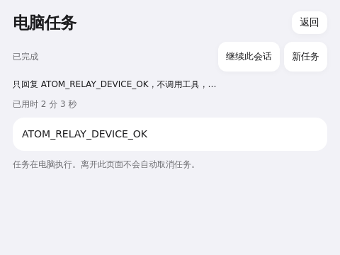
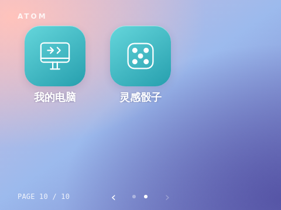
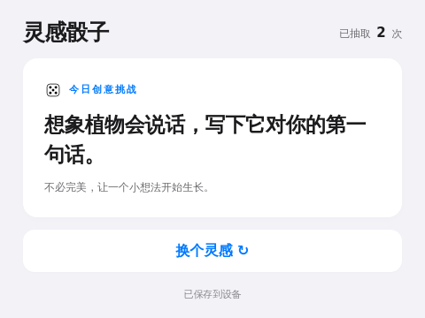

# ATOM Connect 阶段验收 · 2026-10-20

本次为开发环境验收，不代表生产公网服务器已经上线。

## 真机与真实模型

设备为 RK3566 Debian，实体桌面 480×360。设备通过反向 SSH 的回环转发访问 Mac 上的开发中继；电脑伴侣通过同一中继轮询。配对码由设备生成，电脑输入后，由设备明确确认。

1. 真机「我的电脑」选择临时空目录授权的只读项目，发送要求只回复 `ATOM_RELAY_DEVICE_OK` 的任务。电脑上的真实 Codex CLI 创建会话并执行，约 123 秒后产生 completed 和相同文本，设备实际显示完成。此目录没有产生文件。
2. 真机点击「继续此会话」发送第二个只读请求。电脑沿用同一个 session_id，真实返回 `ATOM_RESUME_OK`，状态 completed。
3. 真机发送第三个任务后点击取消，状态真实变为 cancelled；没有把取消显示成完成。
4. 在「我的电脑」长按空格，实际录音 start 返回 200；松键触发 stop 返回 200。录音后状态 recording=false，风扇控制器 quiet=false，任务数量仍为 3，转写不会自动发送任务。此检查不评价 ASR 识别准确率。
5. 应用已更新到设备。桌面图标为自己的 currentColor SVG，安装追加，更新保留位置。真机从应用退出回到第 10 页；在桌面再按空格回第 1 页。

## 自动化检查

- 设备 Python 测试：54 项通过。
- 中继持久化、认证、配对、任务等测试：8 项通过。
- 电脑适配器、重试、隔离、审批、取消和本地控制台测试：12 项通过。
- 设备应用 Chrome fixture 测试：提交、实际状态呈现、审批、取消确认、语音草稿、480×360、读取失败保护、保存失败不提交、任务失效停止轮询、12000 中文字、会话续接、耗时与清理通过。父桥和模型回应是测试替身，不当作真实推理。
- SHA-256 指纹与 Node crypto 对照通过。
- 根 shell JavaScript 语法、Python 编译检查通过。

审批交互由协议及适配器测试验证；本次真实 Codex 只读请求没有触发需要人工批准的命令，因此不宣称完成了真实危险命令审批验收。

## macOS 开发包

`desktop/build-macos.py` 成功构建原生 AppKit/WebKit 外壳，包含独立 Node。`codesign --verify --deep --strict` 通过；启动后原生进程和子 Node 正常，回环控制台 GET 返回 200。当前机器没有授予原生 UI 自动化权限，因此未完成原生菜单、文件夹选择器的点击验收。开发包没有 Developer ID 公证；Windows 原生包未交付。

## 尚未完成的生产工作

公网 TLS 中继、账号/邀请、设备撤销和恢复、数据保留策略及监控，需在正式服务器环境继续建设。Claude 官方 SDK 适配已做替身测试，尚无真实 API 凭据验证。当前采用有身份校验的 HTTP 持久轮询，没有实现端到端加密或 WebSocket；中继运营者可访问任务文本。

## 应用生成 → 预览 → 确认安装（2026-10-20）

真机「我的电脑」创建应用模式，通过中继交给 Mac 原生伴侣中的真实 Codex，生成「灵感骰子」完整 bundle。任务 `4aa98371a6d5d1cea053685ad7f24ec2` 为 app 类型并完成，非预制应用替身。设备点击全屏预览，空格返回原桌面页，再进入我的电脑并二次确认安装；桌面末尾出现独立骰子图标。

安装后按钮实际更换挑战，抽取次数从 1 变 2。退出重进保持 2；再进入临时预览抽取到 3 次，返回安装应用仍为 2，确认两种存储隔离。480×360 无整页溢出。生成示例的预览状态文字没有区分存储模式，但已验证未写入设备持久存储；后续生成提示已明确要求根据保存 ACK.mode 区分文案。

补齐保护：通用生成/导入/更新不能占用 my-computer 或 connect-preview；Connect 客户端的人工审核部署使用受本机同源、开发模式保护的专用 client-update 路径，普通 app 的消息桥不暴露该操作。预览存储按任务分区，设备在桌面和其他应用中仍发送连接心跳。

本轮回归：设备 Python 57 项、电脑 16 项、中继 11 项通过，共 84 项；另有 Chrome 应用创建/预览/二次确认安装、长文本、导航、存储、SHA 指纹测试通过。

