# ATOM 小游戏候选清单（第二版）

可视化版本：本目录 `game-picks.html`（单文件、图片内嵌，下载后用浏览器打开）。结构化数据：`candidates.json`。任务说明与待办见 [README.md](README.md)。

## 一、体感游戏（倾斜/晃动键盘控制光标）

### The Aviator 小飞机 ⭐推荐首批

- 仓库：https://github.com/yakudoo/TheAviator  
- 原作者：Karim Maaloul（Codrops 教程作品）  
- 许可证：Codrops 许可：可修改后用于个人/商业项目，不得原样再发布  
- 品类：3D 飞行；适配难度：中

**玩法**：低多边形卡通飞机绕着海面飞行：吃蓝色能量球，躲开红色障碍，越飞越快。

**体感玩法**：飞机直接跟随光标位置：抬起/放低键盘让飞机升降，左右倾斜调速度。完全不用按键。

**亮点**：整套低多边形画风、云朵、海浪和飞行员的头发都在实时动画，是这批里最好看的一个。

**为什么适合**：只需要光标位置；原版自适应全屏，480×360 下画面完整。

**适配与风险**：

- Three.js + 实时阴影，Mali 上要实测帧率，可能需关阴影或降分辨率
- 许可要求不原样再发布：只能改造后装在自己设备上，不能当原版传播
- 去掉顶部 Part1/Part2 导航与外部字体，最远距离存 AtomApp

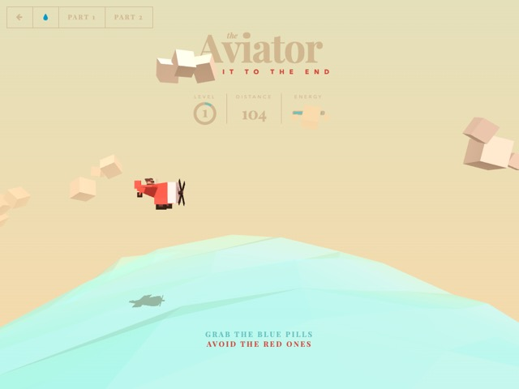  
出处：用原仓库代码在本机运行、以模拟鼠标移动驱动后的截图（作者官方演示页 tympanus.net 有人机验证，仓库内无截图）

### Air Hockey 3D 桌上冰球 ⭐推荐首批

- 仓库：https://github.com/MortimerGoro/AirHockeyWebGL  
- 原作者：MortimerGoro  
- 许可证：MIT  
- 品类：3D 对战；适配难度：中

**玩法**：3D 桌上冰球对战电脑：推球击进对方球门，可调难度和同时出现的球数。

**体感玩法**：球拍跟随光标：晃动键盘就是挥拍，快速一甩能把球打出去。

**亮点**：Three.js 立体球桌 + Box2D 真实碰撞反弹，多球模式很热闹。

**为什么适合**：只要光标位置；画面本来就是全屏 3D，视角可切换。

**适配与风险**：

- 右上角 dat.GUI 设置面板要换成小屏菜单
- 旧版 Three.js + Box2D，需在 Mali 上测帧率
- 比分记录存 AtomApp

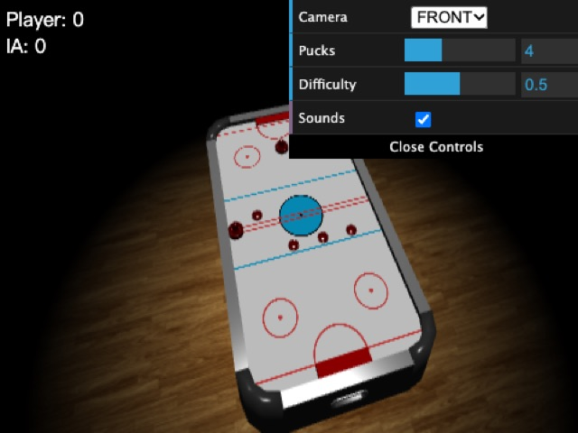  
出处：作者官方 GitHub Pages（mortimergoro.github.io/AirHockeyWebGL）在 480×360 下的截图（仓库内无截图）

### Radius Raid 霓虹射击 ⭐推荐首批

- 仓库：https://github.com/jackrugile/radius-raid-js13k  
- 原作者：Jack Rugile  
- 许可证：MIT  
- 品类：射击；适配难度：低–中

**玩法**：太空双摇杆射击：13 种敌人、5 种道具，一波一波清场。

**体感玩法**：WASD/方向键移动，倾斜键盘瞄准，F 开自动开火。左手按键走位，键盘本身当准星，这台机器上最合适的玩法。

**亮点**：霓虹光圈、视差星空、粒子爆炸，整个游戏只有 13 KB。

**为什么适合**：原生就是“键盘移动 + 鼠标瞄准”，正好对应这把键盘；Canvas 2D，没有 WebGL 负担。

**适配与风险**：

- 原版 800×600，需要缩放到 480×360 并调大文字
- 粒子多时 RK3566 可能掉帧，需要限制粒子数
- 最高分原存 localStorage，改为 AtomApp

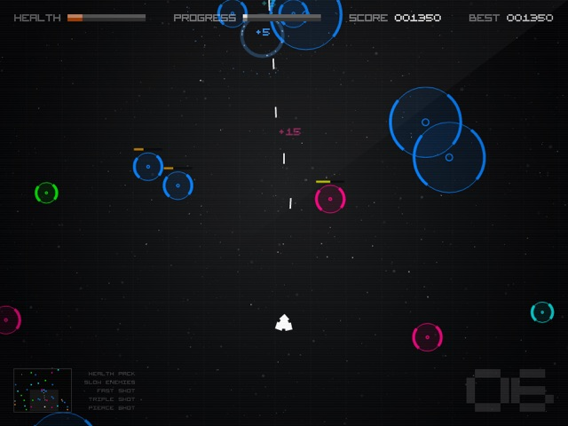  
出处：原仓库 README 引用的作者截图（jackrugile.com/radius-raid/images/gameplay-screenshot.png）

### Astray 迷宫滚球 ⭐推荐首批

- 仓库：https://github.com/wwwtyro/Astray  
- 原作者：Rye Terrell  
- 许可证：Unlicense（公有领域）  
- 品类：3D 迷宫；适配难度：中

**玩法**：用方向键滚动发光小球，在砖墙迷宫里找出口，关卡越来越大。

**体感玩法**：把光标的移动当成倾斜：歪键盘让小球朝那个方向滚，就是实体的迷宫倾斜玩具。

**亮点**：砖墙迷宫加小球发光，有实时光影，3D 感很强。

**为什么适合**：方向键/WASD 控制；本来就是全屏自适应，480×360 下画面完整（见截图）。

**适配与风险**：

- 需要把方向键改成“光标偏移 → 倾斜力”，光标到屏幕边缘就不能继续移动，要做回中处理
- Three.js（旧版）+ Box2D 的 WebGL 场景，需在 Mali 上实测帧率，可能要降分辨率或关阴影
- 依赖 jQuery 和旧版 three.js，需固定在包内
- 去掉右上角 GitHub 角标，关卡进度存 AtomApp

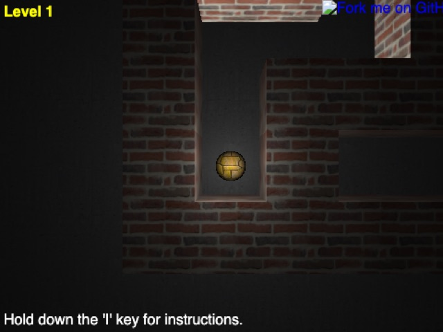  
出处：作者官方 GitHub Pages（wwwtyro.github.io/Astray）在 480×360 下的截图（仓库内没有截图）

### Duck Hunt JS 打鸭子

- 仓库：https://github.com/MattSurabian/DuckHunt-JS  
- 原作者：Matt Surabian  
- 许可证：代码 MIT；画面和音效是任天堂原版素材  
- 品类：光枪射击；适配难度：低–中

**玩法**：FC 打鸭子：鸭子飞出草丛，瞄准射击，猎犬叼鸭或嘲笑你。

**体感玩法**：键盘就是光枪：倾斜瞄准，按回车或鼠标键开枪。体感最直观的一个。

**亮点**：原汁原味的 FC 画面和音效，猎犬动画齐全。

**为什么适合**：只需光标 + 一个开火键；PixiJS 2D，性能压力小。

**适配与风险**：

- 美术和音效是任天堂的原版素材：只适合装在自己机器上玩，不能分发；想分发就得重画
- 音效 700 KB，整包约 1.5 MB
- 需把开火映射到回车（键盘若有鼠标左键也可用）

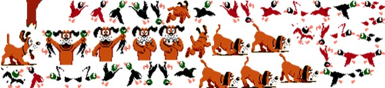  
出处：原仓库 dist/sprites.png 精灵图节选（无头浏览器下 WebGL 画面未能截出）

### snake.io 贪吃蛇大作战

- 仓库：https://github.com/bibhuticoder/snake.io  
- 原作者：Bibhuti Poudyal  
- 许可证：MIT  
- 品类：休闲对战；适配难度：低

**玩法**：类似 Slither.io：和一群电脑蛇抢豆子，撞到别人身体就死。

**体感玩法**：蛇头追着光标方向游：倾斜键盘转向，玩法和手机上的贪吃蛇大作战一致。

**亮点**：一群 AI 蛇互相围堵，比单人贪吃蛇热闹；画面比较朴素。

**为什么适合**：只需光标；纯 Canvas 2D 矢量绘制，非常轻。

**适配与风险**：

- 原版没有菜单、背景和结算界面，需要补
- AI 较简单，作者自己也写了待改进
- 画面需要美化才够好看

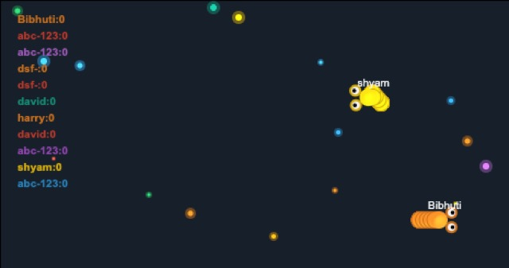  
出处：作者官方 GitHub Pages（bibhuticoder.github.io/snake.io）截图，已裁去空白（仓库内只有原理图）

### Bubble Shooter 泡泡龙

- 仓库：https://github.com/rembound/Bubble-Shooter-HTML5  
- 原作者：Rembound（Rembound.com）  
- 许可证：MIT  
- 品类：益智射击；适配难度：低

**玩法**：泡泡龙：瞄准发射彩色泡泡，三个同色相连消除。

**体感玩法**：倾斜键盘调发射角度，回车发射，比方向键微调顺手得多。

**亮点**：玩法耐玩；画面是教程级的简单圆球，需要美化。

**为什么适合**：Canvas 2D，体积几十 KB；横屏比例接近。

**适配与风险**：

- 原版是教程代码，没有关卡和音效，需要补
- 画面朴素，需要加泡泡贴图和动画
- 最高分存 AtomApp

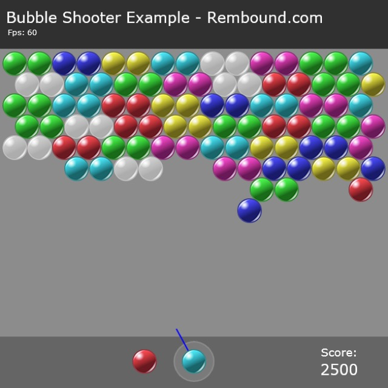  
出处：原仓库 screenshot.png

## 二、键盘游戏（可加体感）

### 2048

- 仓库：https://github.com/gabrielecirulli/2048  
- 原作者：Gabriele Cirulli  
- 许可证：MIT  
- 品类：益智；适配难度：低

**玩法**：方向键滑动数字方块，相同数字相撞合并，目标拼出 2048。

**体感玩法**：可加：把键盘向一个方向快速一甩，判定成一次滑动。

**亮点**：简单耐玩，最高分有成就感；画面平平。

**为什么适合**：只用方向键，回合制无时间压力；纯 DOM+CSS，几乎不占 GPU。

**适配与风险**：

- 原版是竖向排版（标题+棋盘+说明），需改成横屏：棋盘靠左、分数放右侧
- 最高分原存 localStorage，改为 AtomApp.save
- 体积 <200 KB，无网络依赖，不用空格

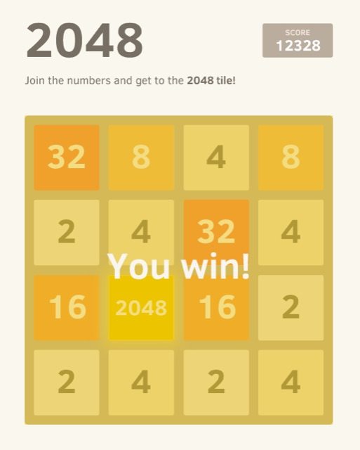  
出处：原仓库 README 截图（cloud.githubusercontent.com，作者上传）

### Hextris ⭐推荐首批

- 仓库：https://github.com/Hextris/hextris  
- 原作者：Logan Engstrom、Garrett Finucane、Noah Moroze、Michael Yang  
- 许可证：GPL-3.0  
- 品类：益智街机；适配难度：中

**玩法**：六边形中心旋转，接住四面飞来的彩色方块，三块同色相连消除。

**体感玩法**：可加：左右倾斜键盘来旋转六边形。

**亮点**：节奏快、颜色明快，一局就上手。

**为什么适合**：只用 ←/→ 旋转，节奏快、一局几分钟；Canvas 2D 负载小。

**适配与风险**：

- 480×360 下原版布局偏离（见截图），需重算缩放与居中
- 需去掉 Facebook/Twitter/应用商店按钮和外链
- GPL-3.0：移植版也须以 GPL 发布并附源码
- 依赖 jQuery，仓库 27 MB 但实际游戏资源很小

  
出处：原仓库 images/twitter-opengraph.png（仓库内没有游戏截图）

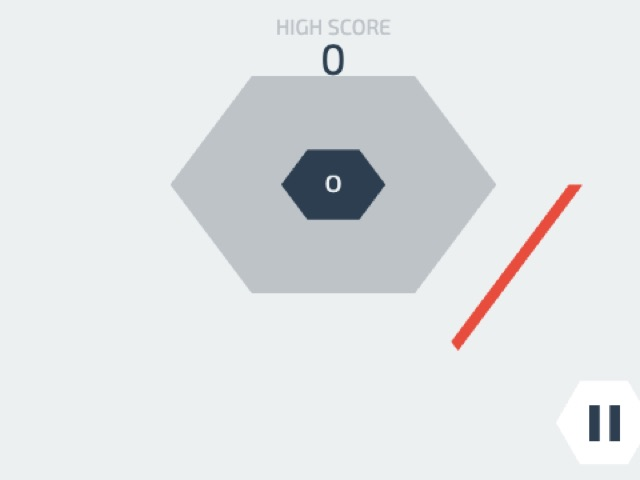  
出处：用原仓库 gh-pages 代码在 480×360 下直接运行的截图（未适配前：棋盘偏上，右下暂停按钮被裁切）

### Blockrain.js 方块

- 仓库：https://github.com/Aerolab/blockrain.js  
- 原作者：Aerolab  
- 许可证：MIT  
- 品类：益智（俄罗斯方块类）；适配难度：低

**玩法**：下落方块消行；自带 AI 自动演示模式，可当待机画面。

**体感玩法**：可加：向下一甩直接落到底。

**亮点**：自带 AI 自动演示，放着就能看。

**为什么适合**：←/→ 移动、↑ 或 X/Z 旋转、↓ 下落，原生就不用空格；Canvas 2D，主题和尺寸可配置。

**适配与风险**：

- 依赖 jQuery 插件写法，需整理成单页
- 横屏要把下一块预览和分数挪到棋盘右侧
- 最高分改用 AtomApp 保存

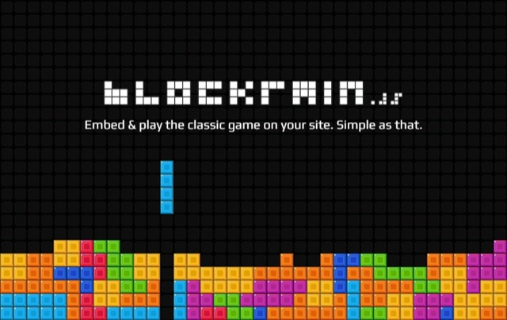  
出处：原仓库 gh-pages 分支 assets/images/blockrain.png

### T-Rex Runner 小恐龙 ⭐推荐首批

- 仓库：https://github.com/wayou/t-rex-runner  
- 原作者：The Chromium Authors（wayou 从 Chromium 中提取）  
- 许可证：BSD-3-Clause  
- 品类：跑酷；适配难度：低

**玩法**：Chrome 断网小恐龙：跳过仙人掌、躲开翼龙，越跑越快。

**体感玩法**：可加：把键盘向上一抖就是跳，向下压是蹲。

**亮点**：人人都认识的断网小恐龙。

**为什么适合**：只需 ↑ 跳、↓ 蹲；画面本身就是 600×150 横条，480 宽完全放得下。

**适配与风险**：

- 原版用空格跳：改为 ↑/回车跳，空格保留给返回桌面
- 图片与音效已内嵌在页面里，离线无问题
- Chromium 的版权声明需要保留

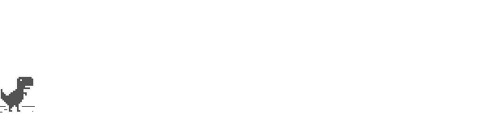  
出处：原仓库 assets/screenshot.gif

### Clumsy Bird ⭐推荐首批

- 仓库：https://github.com/ellisonleao/clumsy-bird  
- 原作者：Ellison Leão  
- 许可证：GPL-3.0  
- 品类：休闲；适配难度：低–中

**玩法**：Flappy Bird 式：按键拍翅膀，穿过管道缝隙。

**体感玩法**：可加：向上挥一下键盘就拍一次翅膀，像真的在扇。

**亮点**：像素风 Flappy Bird，挥键盘飞会很有喜感。

**为什么适合**：单键操作，像素风，melonJS 引擎在低端设备上也流畅。

**适配与风险**：

- 原版用空格/点击拍翅膀：改为 ↑/回车
- melonJS 是较老版本，需确认在 Chromium 沙箱 iframe 中正常
- GPL-3.0：移植版也须以 GPL 发布
- 体积约 4 MB（含音效）

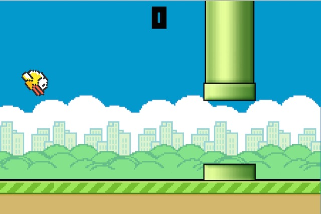  
出处：原仓库 README 引用的作者截图（i.imgur.com/Slbvt65.png）

### Bombergirl 炸弹人 ⭐推荐首批

- 仓库：https://github.com/MattSkala/html5-bombergirl  
- 原作者：Matouš Skála  
- 许可证：代码 MIT；配乐 CC BY-SA 4.0；美术 Hyptosis / LPC（CC 署名类）  
- 品类：动作；适配难度：中

**玩法**：炸弹人：放炸弹炸开箱子、拾取道具，对战 3 个电脑对手。

**体感玩法**：保持方向键，走格子游戏不适合体感。

**亮点**：和 3 个电脑对手混战，节奏紧张。

**为什么适合**：方向键移动，有单人对 AI 模式；原生 544×416，缩放 0.86 倍正好塞进 480×360。

**适配与风险**：

- 原版用空格放炸弹：改为回车/X
- 依赖 EaselJS/PreloadJS/SoundJS（bower 安装），需固定版本放进包里
- 美术和配乐是 CC 署名/相同方式共享，要在应用里写清署名
- 双人模式要两人共用一个键盘

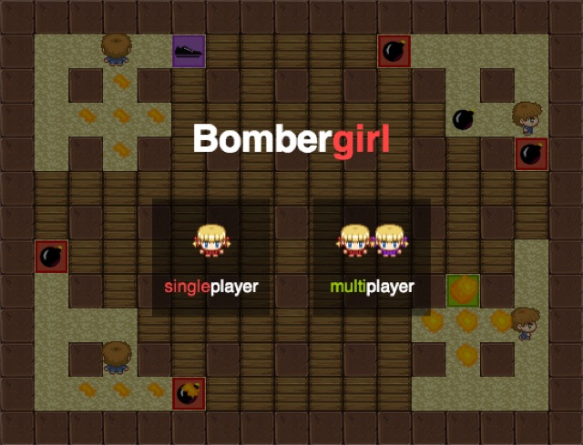  
出处：原仓库 README 引用的作者截图（matousskala.cz/files/bomberman_screen.png）

### Sokoban.js 推箱子

- 仓库：https://github.com/taniarascia/sokoban  
- 原作者：Tania Rascia  
- 许可证：MIT  
- 品类：益智；适配难度：低–中

**玩法**：经典推箱子：把所有箱子推到目标点上。

**体感玩法**：保持方向键，推箱子不适合体感。

**亮点**：安静的动脑游戏；原版只有 1 关。

**为什么适合**：方向键逐格移动，网格可以按 360 高度缩放；原生 ES 模块，无构建步骤。

**适配与风险**：

- 原版只有 1 关，需要自己补关卡（自制或选用允许再分发的关卡集）
- 需加撤销/重开按键、通关进度存 AtomApp
- 代码约 10 KB，无依赖

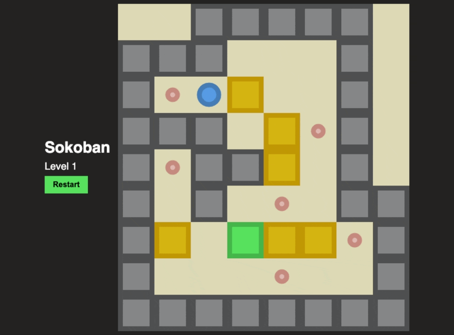  
出处：原仓库 README 动图（user-images.githubusercontent.com，作者上传）
