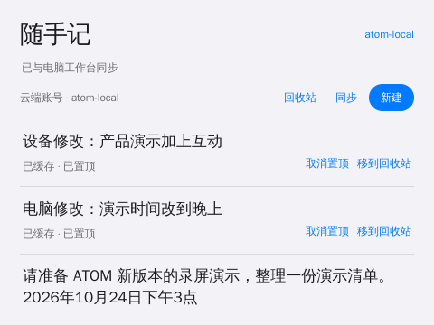

# 官方应用视觉改版 · 2026-10-20

本轮已更新样机上的九个客户端：今日、随手记、云朵伙伴、任务伙伴、声音实验室、像素实验室、应用市场、我的电脑、应用库。应用数据、安装时间、图标和桌面顺序保留。旧资源与状态已在样机私有目录备份，不进入仓库。

## 设计与交互

- 固定 480×360 画布，统一标题层级、屏幕边距、表单密度与列表分组。正文优先于按钮，主操作用主题强调色，次要操作用文字。
- 便签变为紧凑的笔记列表；日程以日期、勾选与事项为重点；市场以应用名称和描述为主，减少多层卡片。
- 音序器四轨颜色具有实际含义，保留蓝/紫/金/绿，避免主题强制成同一颜色；任务伙伴突出表情与真实状态，点阵保留完整计算场景。
- 「我的电脑」分为发起任务与最近任务；连接设置分为服务连接与配对电脑。普通发起/配置表单固定一屏，不把任务历史塞在输入框下面。
- 根文档固定且禁止滚动；仅便签、事项、应用目录、任务列表、正文或源码等必要内容区内部滚动。所有官方页面隐藏滚动条，但长内容保留滚轮/触摸操作，不靠裁切删除功能。
- 电脑界面的编排只改 DOM 展示，不更改 Agent 权限、任务提交、配对或持久化语义。

## 可维护的设计源

`atom/design/device-ui.css` 为共享设计源。`sync_device_ui.py` 在各应用构建时自动复制为离线资源 `device-ui.css`，并与源码一起进入包。各客户端 `style.css` 保留原有基础与专用场景样式。主题仍通过系统令牌接入；已为官方控件明确处理主题中高优先级通用按钮样式的覆盖，避免真机与单独浏览器预览不一致。

构建、协作与部署步骤见 [collaboration.md](collaboration.md)。每个应用继续使用独立、可主题化的语义图标。没有引入在线字体、外链 CDN、远程图片或重型模糊效果。

## 验证

- 三组真实浏览器测试通过：市场/便签/伙伴/点阵/任务；今日与真实 WebAudio；电脑提交/审批/取消/语音草稿/安装确认与存储失败。
- 测试入口改为可移植的 Playwright 模块与浏览器配置，不再要求协作者拥有开发者本机的绝对路径。npm 依赖已锁定。
- 九个应用在 RK3566 真机逐一打开：根文档均为 480×360，滚动条计算样式为隐藏。声音、点阵、伙伴与电脑发起页无纵向滚动；长列表按内容需要滚动。
- 真机服务连接配置面板的内容高度与可用高度均为 238px，未以隐藏溢出来掩盖被截断的表单。
- 更新前后应用数量、顺序与安装时间核对一致，没有删除或重新安装用户数据。

真机检查记录见 [verification.json](../artifacts/official-ui-refresh/verification.json)。截图中显示的是验收时的真实测试账号与演示内容，不包含密钥。浏览器 fixtures 不被当成真实模型、扬声器听感或 GPU 帧率证据。

