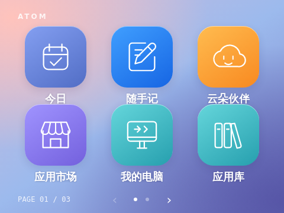
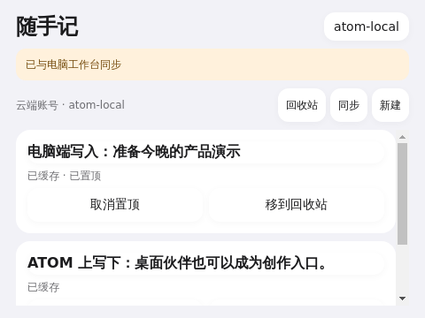
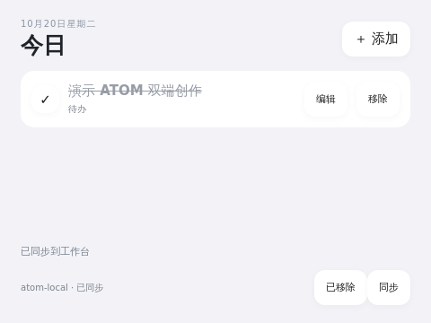
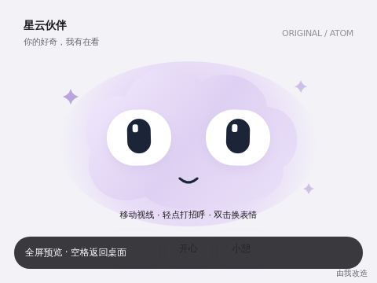
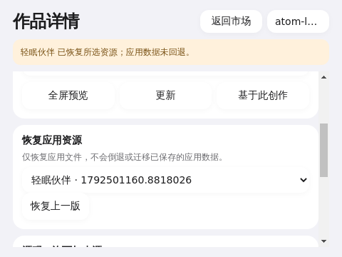
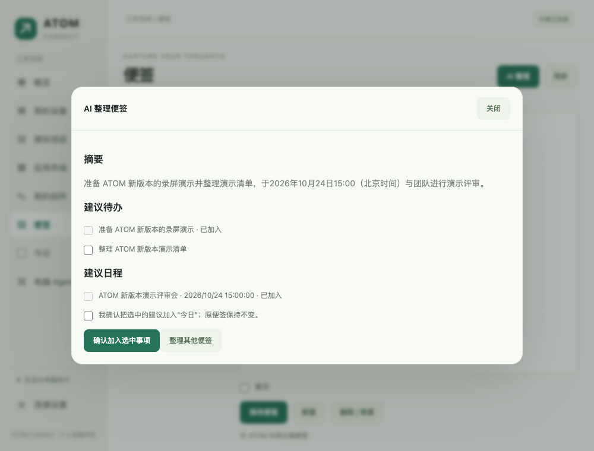
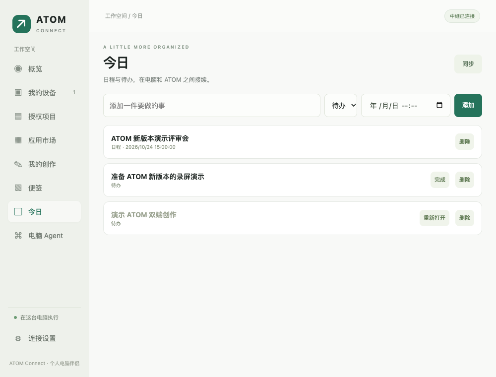

# ATOM Studio 本轮交付与使用说明

交付日期：2026-10-20。当前是已部署在样机与开发 Mac 上、真实联网验收的开发版本。不是已部署的公网商业服务。

## 产品结构

- **ATOM 小电脑**：独立全屏桌面、轻应用、语音输入和互动呈现。个人电脑离线时，本地应用与本地记录继续可用；需要云端的功能如实显示离线状态。
- **ATOM Connect / Studio 电脑端**：配对个人设备、选择项目和 Agent；编辑应用完整源码、快照与差异、AI 改造、预览、同步草稿、明确发布；管理便签、日程与待办。
- **自托管平台**：配对与中继、账号、源码市场、版本及派生关系、账号数据同步。测试环境位于当前 Mac，设备通过既有 SSH 隧道连接。未来迁移到云服务器不需要把个人电脑上的 Agent 搬到云端。

配对凭据与市场账号是不同的权限边界。市场登录不会授权读取任意电脑文件，电脑任务仍受授权项目、适配器和审批规则约束。

## 已交付的创作闭环

1. 在电脑端或设备的「应用市场」查看分类、作品、作者、许可、完整源码和历史版本。
2. 选择版本并「基于此创作」，生成自己的私有草稿。原作品不会被修改；来源和许可保留。
3. 在电脑 Studio 编辑完整文件，保存本地工作区，查看差异并创建快照；或提交 AI 改造需求。
4. AI 任务展示真实状态。Studio 改造通道只返回文本源码，不向模型开放本机工具；产物校验后才能使用。失败不会自动发布。
5. 预览、检查图标和交互，保存到服务器，再明确确认发布。
6. 小电脑预览后确认安装，新的应用追加到桌面末尾。更新保留位置；资源回退保留应用数据。
7. 其他用户可以继续派生与发布，作品详情保留父作品和具体父版本。

市场版本不可变。改源码后发布新版本，不会偷偷替换已有版本。应用图标随系统主题渲染，每个应用都有自己的静态语义 SVG。

## 双端数据

「随手记」与「今日」按市场账号同步。设备先取得本地保存确认，再报告保存成功；离线明确显示待同步。读取失败提供重试，避免以默认内容覆盖已有记录。

同一条记录被两端同时修改时，可保留服务器版本或保留双方。软删除可恢复。更换账号不会把上一账号的待同步队列上传给下一账号。

电脑端 AI 整理便签只生成摘要及候选待办、日程。原文保持不变；勾选并明确确认后才加入数据队列。重复确认使用固定 ID，避免重复添加。

应用第一次访问便签、日程或电脑任务摘要时需要用户授权。预览不会获得这些权限；可在设备设置的「应用权限」撤销授权。

## 五个原创官方示例

| 类别 | 应用 | 实际功能 |
| --- | --- | --- |
| 生活 | 今日 | 账号待办、日程、完成状态、软删除恢复、离线队列及冲突处理 |
| 陪伴 | 云朵伙伴 | 视线追踪、眨眼、点击回应、三种心情及偏好保存 |
| 声音 | 声音实验室 | 四轨十六步音序器、速度音量、预设与保存，真实 WebAudio 合成 |
| 互动 | 像素实验室 | 生命规则、沙粒与涟漪计算，绘制、暂停、种子及撤销 |
| 连接 | 任务伙伴 | 已配对电脑任务及 Studio 活动状态；离线与失败明确显示 |

原有移植作品保留在桌面上，排在常用入口之后。2026-10-21 起不再提供「应用库」；`app-library` 仍是保留 ID，其他应用不能占用。

## 真实验收记录

- 使用真实 Codex 模型完成一次完整源码改造并发布；实际请求工具列表为空。
- 第二个市场账号派生作品，发布两个版本；私有草稿隔离、父版本关联和不可变哈希均已核对。
- 样机预览真实 AI 作品；安装第二账号作品、更新后保留位置、回退到旧资源，并打开核对实际文字。
- 电脑写便签，设备读取；设备写便签，电脑读取；电脑建待办，设备完成后电脑状态更新。
- 实际断开设备到中继的隧道，设备离线编辑并重载；电脑同时修改同一便签。恢复隧道后出现冲突，保留双方后服务器存在两条完整内容。
- 最新原生 Mac 构建中，真实模型整理便签完成，产生 2 条待办和 1 条日程候选；确认其中 1 条待办与 1 条日程，重复确认后服务器各仅 1 条。原文及修订号未改变。
- 样机声音实验室实际推进到 STEP 06 并可暂停，像素实验室 Canvas 可点击，任务伙伴读取真实电脑在线状态及「整理便签」活动。
- 本轮核心回归：设备 Python 62 项、电脑 Node 36 项、中继 12 项、市场 18 项，共 128 项通过；另有生命周期与浏览器交互测试。
- 设备服务与 Shell 整合通过运行时检查；应用生命周期、隔离、持久化确认、权限与安装资源测试覆盖自动化回归。

截图：

以下电脑端截图来自运行中的原生 App 后端在独立浏览器中的渲染，非 macOS 窗口截图：

## 本机运行与运维

Mac 应用构建产物为 `atom/connect/dist/ATOM Connect.app`，运行入口与构建命令见 [Connect 指南](../connect/README.md)。它是本机签名的开发构建，未做 Apple 公证或 Windows 安装包交付。

本机中继监听 `127.0.0.1:19441`，由用户 LaunchAgent 托管；另一个 LaunchAgent 维持到设备的测试隧道。请保持 Mac 唤醒、电脑端应用运行及网络连接。不要把 localhost 测试入口直接当公网服务暴露。

账号令牌、配对状态和工作区保存在当前用户的 `Library/Application Support/ATOMConnect`，设备市场令牌保存在设备私有状态目录，不在应用源码中。验收账号凭据仅保存在该 Mac 的私有 `acceptance-accounts.json`，不写入仓库或截图。应用内支持注册、登录和退出。

平台健康检查、统计、备份及作品下架/恢复操作见 [市场运维说明](../connect/marketplace/README.md)。发布到云端前须部署 HTTPS、数据库备份与恢复、限流及账号运营流程；本轮没有部署这些公网基础设施。

## 明确限制

- 市场安装包目前是完整 UTF-8 Web 应用资源，最大 1 MiB；不是任意 Debian 软件安装器。AI 改造交付包另有更严格的大小约束。
- 每应用设备 JSON 数据上限 64 KiB；资源回退不回滚用户数据。
- 市场含基础包校验和凭据扫描，不代表生产级恶意代码审核。第三方源码仍需审查与许可遵守。
- 联网主题市场、第三方日历账号集成、多人实时协作、托管公网服务及端到端加密不在本轮交付范围。
- 浏览器 fixture 测试用于确定交互边界，不被当作真机性能或真实录音效果证据。声音生成已验证音频执行路径，最终听感仍受样机扬声器影响。
