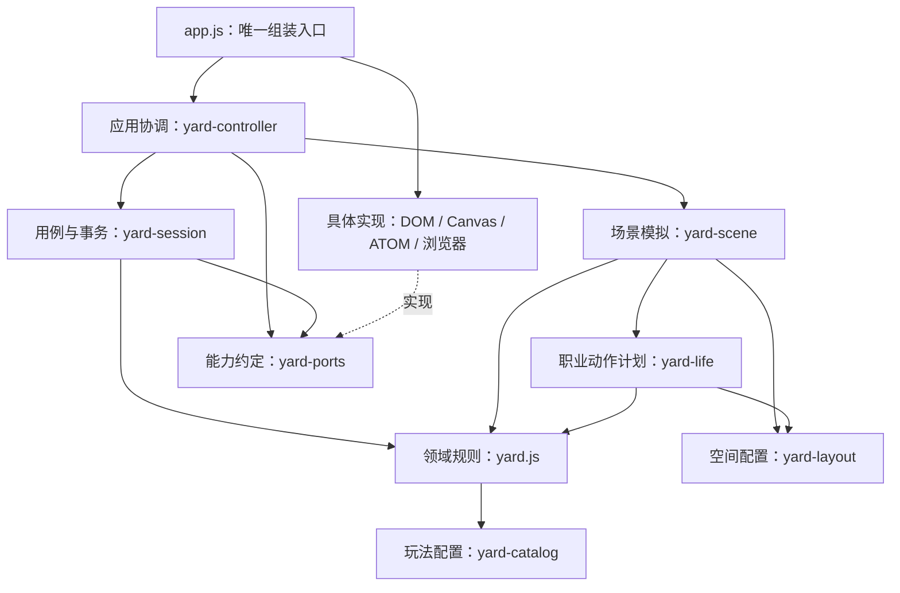

# 宠物小院：依赖、状态与场景

本应用采用经典脚本工厂和依赖注入，兼容设备 Chromium 91 与 ATOM 的不透明 iframe。没有新增框架、远程资源或模型调用。上层通过下层公开的能力接口协作；具体设备、DOM 和 Canvas 实现从启动入口注入，核心不能反向引用具体实现。

## 依赖方向



图中的接口依赖是逻辑依赖：核心接收能力对象，不导入具体模块。`yard-ports.js` 在组装时校验必需方法；测试可替换仓库、时钟、画面、主循环等实现。除了 `app.js`，生产模块不能通过其他模块的全局名字获取实例。脚本的唯一全局行为是导出自身工厂。

| 层 | 模块 | 负责 | 禁止 |
|---|---|---|---|
| 玩法配置 | `yard-catalog.js` | 宠物 ID、职业内容、成长参数、版本化照料计划 | 屏幕坐标、I/O |
| 领域规则 | `yard.js` | 存档校验迁移、命令、库存、奖励、成长、任务状态、只读投影 | DOM、Canvas、时钟读取、保存、动作播放 |
| 应用用例 | `yard-session.js` | 读取保护、写入互斥、确认后提交、失败保留、挂起保护 | 设备 SDK、DOM、绘制 |
| 应用协调 | `yard-controller.js` | 输入意图、用例调用、单帧时间采样、生命周期协调 | 直接读 DOM、库存计算、实例化具体适配器 |
| 场景模拟 | `yard-scene.js` | 移动、跟随、操作优先级、暂停/恢复、完整画面数据 | 保存、领取奖励、直接绘图 |
| 动作计划 | `yard-life.js`、`yard-layout.js` | 职业阶段、行走路线、空闲活动、位置 | 修改存档、自己设置计时器 |
| DOM 实现 | `yard-view.js` | 中文文本、按钮、模态框、焦点恢复、意图回调 | 修改游戏状态、判断奖励、直接调用 ATOM |
| Canvas 实现 | `yard-renderer.js`、`yard-rig.js`、`yard-environment.js`、`renderer.js` | 根据画面数据绘制、肢体约束、纹理缓存 | 读取存档、重新判断作物/任务状态、另读当前时间 |
| 平台实现 | `yard-platform.js` | AtomApp、浏览器时钟、唯一主循环、可见性/动画设置/输入监听 | 玩法和角色判断 |
| 组装 | `app.js` | 创建实现、校验接口、注入依赖、启动 | 业务分支、动画、界面细节 |

`pets.js` 和 `assets.js` 是展示素材。旧版单宠物互动实验移入 `legacy/`，不加载、不打包。构建从 `index.html` 收集资源，不再手工维护另一份运行脚本清单。

## 一次操作的完整路径

1. DOM 只发出意图，例如 `{kind: 'plot', index: 1}`。
2. 协调层让场景安排路线。途中改选目标，旧意图立即取消；打开面板、返回、挂起也会取消路线。
3. 到达时场景只交回命令，不直接调用存储或业务函数。
4. 用例层使用同一份已确认状态和注入时间调用领域命令。领域返回候选状态、反馈代码和语义事件。
5. 仓库保存确认前，旧状态继续有效；重复操作被互斥挡住。失败保留原状态和成果；读取失败时拒绝派工、领取和写入。
6. 确认后才替换只读状态、更新库存、向场景发出浇水/采收/进食等反馈事件。UI 再显示成功。

不使用全局事件总线，不逐帧持久化。保存中的挂起不会阻止已经送出的设备保存，但确认返回后不再更新已销毁的界面。

## 两种时间各做什么

| 时间 | 来源 | 用途 |
|---|---|---|
| 现实时间 | 注入的 `clock.wall()` | 成长、工作截止、离线恢复、领取资格 |
| 单调时间 | 注入的 `clock.monotonic()` | 动作、移动步长、无人操作判定、短提示过期 |

协调层每帧只采样一次，领域投影、阶段提示和场景共用它。绘制层收到 `Frame` 后不能自行读时间、计算奖励或解析存档。动画步长上限 100 ms，避免恢复前台后一次跨越整个院子；现实时间仍能让离线任务正常完成。

`Frame` 包含玩家/宠物姿态、居民姿态、作物表现、职业阶段、产物是否可领取、工具摆放、视觉反馈和环境动画开关。`yard-renderer.js` 只消费这些数据，DOM 用同一份数据定位透明点击区和显示任务状态。

## 场景与职业机制

- 居民点击区域覆盖自己的图像，位于菜地点击区上方，底部操作栏保持更高优先级；工作中的园丁也可交互。
- 手动操作优先于宠物闲逛。12 秒无操作才进入自主活动；任意输入立即退出自主活动。不会自行派工、消耗物品或领取奖励。
- 居民按既有任务进度工作，空闲活动只负责生活感。待领取的铁匠整理、打磨工具，不再继续播放打铁产出效果。
- 园丁依次检查、补种、按需浇水、施肥、检查长势、成熟后采收。画面、土壤状态、增产和任务提示来自同一事件计划；保留已有作物。`care:1` 固定当前 96 秒语义，旧 30/60 秒任务保留原截止时间和产量。
- 铁匠的炉中加热、锻打、打磨有不同工具和手势；火花只在锻打接触时出现。渔夫的抛竿、等待、收线和入桶分别表现，等待期间只保留轻微鱼竿动作。
- 打开面板时冻结画面中的人物位置，后台仍按现实时间更新任务资格和倒计时。关闭后若计划位置已改变，人物先走回当前工作位置，再恢复工作动作；不会跳到固定的“35% 任务位置”。
- 减少动态或系统关闭动画时，居民保持固定站位；数据与任务照常推进。隐藏页面停止主循环，返回前台重置动画步长；挂起移除全部计时、帧请求和监听。

## 扩展与验证

新增职业必须同时设计领域数据迁移、任务/奖励规则、动作计划、场景位置和素材。不能只在渲染函数中增加一个人物分支，更不能从绘制层直接写库存。变更持久化事件语义时增加计划版本，避免更新后改写正在进行的旧任务。

验证入口：

```sh
node atom/official/photo-pet/architecture.test.cjs
node atom/official/photo-pet/yard.test.cjs
node atom/official/photo-pet/scene-flow.test.cjs
node atom/official/photo-pet/gardener.test.cjs
node atom/official/photo-pet/motion.test.cjs
python3 atom/official/photo-pet/build.py
python3 atom/tools/prepare_icon_bundles.py
python3 atom/tools/check_app.py atom/official/photo-pet/bundle.json
node atom/official/photo-pet/architecture.test.cjs --bundle
```

架构测试检查核心的环境隔离、全局具体依赖、组装入口规模，并用可替换仓库和时钟验证读取失败、确认式提交、并发、重试与挂起；场景测试检查打断、重新寻位、离线状态和只读性。浏览器测试使用实际五向运行时与真机主题验证完整玩法，像素测试检查工具、骨骼和脚部稳定。自动测试不能替代长时间真机运行或所有姿势的人工观感审核。
